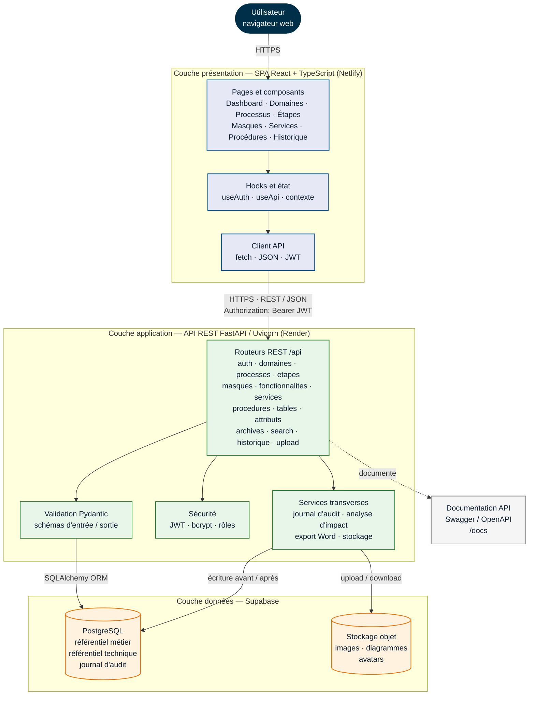
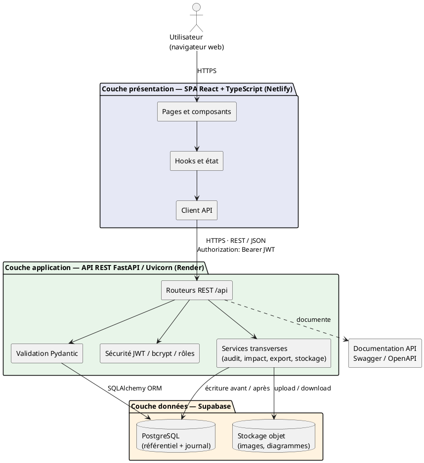

# Chapitre — Conception

## 1. Architecture générale de l'application

### 1.1. Vue d'ensemble

SGB Trésor est une application web de documentation technique du système de
gestion bancaire (SGB). Elle est construite selon une architecture
**client-serveur en trois couches**, qui sépare nettement l'interface
utilisateur, la logique applicative et la persistance des données :

- **couche présentation** : une application monopage (*Single Page
  Application*, SPA) développée en React et TypeScript, exécutée dans le
  navigateur de l'utilisateur ;
- **couche application** : une API REST développée avec FastAPI et servie par
  Uvicorn ;
- **couche données** : une base PostgreSQL hébergée sur Supabase, complétée par
  un stockage objet pour les fichiers (images de masques, diagrammes de
  processus, avatars).

Cette organisation en couches poursuit trois objectifs. D'abord, **découpler**
l'interface et le serveur afin de pouvoir faire évoluer les écrans sans
modifier les règles métier, et inversement. Ensuite, **centraliser** côté
serveur les contrôles de sécurité, de validation et de traçabilité, de sorte
que le navigateur ne puisse jamais contourner une règle. Enfin, **faciliter la
maintenance et les tests** : la logique applicative peut être testée sans
navigateur, et chaque couche possède une responsabilité claire.

Les échanges entre le navigateur et l'API se font en **HTTPS**, au format
**JSON**. Les requêtes protégées transportent un jeton **JWT** dans l'en-tête
`Authorization: Bearer <token>`. L'API est **sans état** (*stateless*) : aucune
session utilisateur n'est conservée en mémoire du serveur, ce qui simplifie le
redémarrage de l'application et sa montée en charge.

Le tableau suivant résume la répartition des responsabilités :

| Couche | Technologies | Rôle principal |
|---|---|---|
| Présentation | React 18, TypeScript, Vite, Tailwind CSS, React Router 6 | Afficher les écrans, collecter les saisies, appeler l'API |
| Application | FastAPI, Uvicorn, Pydantic, SQLAlchemy | Valider, authentifier, appliquer les règles métier, tracer |
| Données | PostgreSQL (Supabase), Supabase Storage | Persister le référentiel, le journal et les fichiers |

### 1.2. Couche présentation

La couche présentation est une application monopage développée avec **React 18
et TypeScript**, compilée par **Vite** et mise en forme avec **Tailwind CSS**.
La navigation est assurée côté client par **React Router 6** : le navigateur ne
recharge pas la page à chaque changement d'écran, ce qui rend l'utilisation plus
fluide et les transitions plus rapides.

Le code du frontend est organisé par responsabilité :

- `pages/` regroupe les vues associées aux routes : tableau de bord, domaines,
  processus, étapes, masques, services, procédures, recherche, historique,
  profil et administration ;
- `components/` contient les composants réutilisables : mise en page
  (`AppLayout`), fil d'Ariane, fenêtres modales, schéma de processus, section
  des fonctionnalités, formulaires et squelettes de chargement ;
- `api/` rassemble les fonctions d'accès à l'API, une par domaine métier,
  construites sur un client commun `client.ts` qui ajoute le jeton JWT, gère
  les erreurs et les téléversements ;
- `hooks/` contient le contexte d'authentification (`useAuth`), le chargement
  des données (`useApi`) et la récupération des images protégées ;
- `types/` centralise les types TypeScript partagés avec les schémas de l'API.

L'état d'authentification est conservé dans un contexte React. Les routes
protégées redirigent vers la page de connexion lorsqu'aucun jeton valide n'est
présent, et la page d'administration est réservée au rôle `admin`. Le jeton est
stocké dans le navigateur, dans `localStorage` ou `sessionStorage` selon que
l'utilisateur a coché ou non l'option « Se souvenir de moi ».

Le build de production génère des fichiers statiques (HTML, CSS, JavaScript)
déployés sur **Netlify**. La variable `VITE_API_URL` permet de pointer vers
l'API correspondant à l'environnement (développement ou production).

### 1.3. Couche application

La couche application est une **API REST** développée avec **FastAPI** et servie
par **Uvicorn**. Toutes les routes sont préfixées par `/api` et sont organisées
en routeurs spécialisés par domaine :

| Routeur | Responsabilité |
|---|---|
| `auth` | Connexion, profil, gestion des utilisateurs |
| `domaines`, `processes`, `etapes` | Couche métier |
| `masques`, `etape_masques` | Écrans et rattachement aux étapes |
| `fonctionnalites` | Actions offertes par un masque |
| `services`, `procedures`, `tables`, `attributs` | Couche technique |
| `archives` | Identifiants de livraison |
| `search` | Recherche globale |
| `historique` | Journal d'audit et export Word |
| `upload` | Téléversement et lecture des fichiers |

Chaque routeur reçoit les données d'entrée sous forme de schémas **Pydantic**,
qui assurent la validation des types, des longueurs et des champs obligatoires
avant d'atteindre la logique métier. Les réponses sont également sérialisées par
des schémas de sortie, ce qui garantit un contrat stable pour le frontend.

FastAPI fournit automatiquement la documentation **OpenAPI / Swagger** de l'API,
consultable à l'adresse `/docs`. Cette documentation sert de référence commune
entre le frontend et le backend.

La couche application s'appuie sur l'injection de dépendances de FastAPI pour :

- ouvrir et fermer une session SQLAlchemy par requête (`get_db`), avec annulation
  de la transaction en cas d'exception ;
- authentifier l'utilisateur (`get_current_user`) en décodant le JWT, en
  rechargeant le compte et en vérifiant qu'il n'est pas bloqué ;
- contrôler les droits (`require_writer`, `require_deleter`, `require_admin`).

Des services transverses complètent les routeurs :

- `historique.py` calcule un instantané « avant / après » et écrit une ligne
  d'audit à chaque création, modification, suppression, rattachement,
  détachement ou réordonnancement ;
- `impact.py` analyse les dépendances avant une suppression afin d'éviter de
  supprimer un objet encore utilisé ailleurs ;
- `storage.py` gère l'envoi, la lecture et la suppression des fichiers dans
  Supabase Storage ;
- l'export Word produit un dossier documentaire à partir de la fiche d'un objet
  et de son journal.

Enfin, un middleware **CORS** limite les origines autorisées. En développement,
tout port `localhost` est accepté pour tenir compte du serveur Vite ; en
production, les origines sont déclarées dans la variable `ALLOWED_ORIGINS`.

### 1.4. Couche données

La couche données repose sur **PostgreSQL**, hébergé sur **Supabase**. Le modèle
relationnel est organisé en trois ensembles cohérents.

**Couche métier** — le contexte fonctionnel :

- `domaines` → `processes` → `etapes` ;
- une étape possède un ordre qui la positionne dans le flux du processus.

**Couche technique** — la structure du code :

- `masques` : écrans de l'application SGB, identifiés par un code ;
- `etape_masques` : association plusieurs-à-plusieurs entre étapes et masques ;
- `fonctionnalites` : actions offertes par un masque ;
- `fonctionnalite_services` : services qui implémentent une fonctionnalité ;
- `masque_services` : services directement rattachés à un masque ;
- `services` : points d'entrée techniques (méthode HTTP, URL, contrôleur,
  descriptions d'entrée et de sortie) ;
- `service_procedures` et `procedures_stockees` : procédures appelées par un
  service ;
- `procedure_tables`, `tables_info` et `attributs` : tables et colonnes
  manipulées.

**Traçabilité** :

- `users` : comptes, rôles et état de blocage ;
- `historique` : journal d'audit avec l'action, le type d'entité, l'identifiant,
  le nom, et les instantanés `avant` / `apres` au format JSONB ;
- `archives` : identifiants de livraison associés aux déploiements.

Les contraintes d'intégrité référentielle (clés étrangères, `ON DELETE CASCADE`
ou `SET NULL`) et les contraintes d'unicité garantissent la cohérence du
référentiel. Les champs JSONB de la table `historique` permettent de conserver
le détail complet d'une modification sans figer le schéma des entités.

Les fichiers (images de masque, diagrammes de processus, avatars) ne sont pas
stockés dans la base : ils sont envoyés dans un **bucket privé Supabase
Storage**. La base ne conserve que la clé du fichier. La lecture passe par la
route authentifiée `/api/upload/{key}`, ce qui évite d'exposer publiquement les
documents internes. Les types autorisés sont PNG, JPEG, GIF, WEBP et PDF, dans
une limite de 10 Mo par fichier.

### 1.5. Environnement de déploiement

L'architecture de déploiement s'articule autour de quatre éléments :

1. le **navigateur de l'utilisateur**, qui exécute la SPA ;
2. **Netlify**, qui héberge les fichiers statiques produits par Vite et sert
   l'application via un CDN ;
3. **Render**, qui exécute l'API FastAPI derrière un reverse proxy assurant
   HTTPS ;
4. **Supabase**, qui fournit la base PostgreSQL et le stockage objet.

Le frontend et l'API sont déployés sur des domaines distincts. Le middleware
CORS de l'API autorise explicitement l'origine du site en production
(`ALLOWED_ORIGINS`), faute de quoi le navigateur bloquerait tous les appels.

La configuration est externalisée dans des variables d'environnement :
`DATABASE_URL`, `JWT_SECRET`, `JWT_ALGORITHM`, `JWT_EXPIRATION_MINUTES`,
`ENVIRONMENT`, `ALLOWED_ORIGINS`, `SUPABASE_URL`, `SUPABASE_KEY` et
`SUPABASE_BUCKET`. Aucun secret n'est intégré au code du frontend : la clé
`service_role` de Supabase reste exclusivement côté serveur.

## 2. Flux de traitement d'une requête

Prenons l'exemple du rattachement d'un service à une fonctionnalité :

1. L'utilisateur ouvre un masque, puis une fonctionnalité, et clique sur
   « Ajouter un service ».
2. Le frontend recherche les services via `GET /api/services?q=...&page=...`,
   puis envoie `POST /api/fonctionnalites/{id}/services/{service_id}` avec le
   jeton JWT dans l'en-tête `Authorization`.
3. Le middleware CORS vérifie l'origine de la requête, puis FastAPI la dirige
   vers le routeur compétent.
4. La dépendance `get_current_user` décode le JWT, vérifie sa signature et son
   expiration, recharge l'utilisateur et contrôle qu'il n'est pas bloqué.
5. La dépendance `require_writer` vérifie que le rôle autorise l'écriture.
6. Le routeur valide les identifiants, ouvre une session SQLAlchemy, vérifie
   l'existence de la fonctionnalité et du service, puis insère la ligne
   d'association.
7. Le service d'historique construit l'instantané « avant / après » et écrit
   l'événement dans le journal, puis la transaction est validée.
8. L'API renvoie une réponse JSON. Le frontend met à jour son état, recharge la
   fonctionnalité et masque le service désormais rattaché.

Ce flux illustre le principe retenu : **le navigateur ne décide de rien**. Il
affiche, collecte les saisies et appelle l'API ; les règles d'autorisation, de
validation, de cohérence et de traçabilité sont appliquées côté serveur.

## 3. Sécurité

La sécurité repose sur plusieurs mécanismes complémentaires :

- **Authentification** : mot de passe vérifié avec `bcrypt`, puis émission d'un
  JWT signé en HS256, valable 24 heures ;
- **Autorisation** : trois rôles — `admin` (tout, y compris les comptes),
  `editor` (créer, modifier, supprimer) et `contributor` (créer et modifier,
  sans suppression) ;
- **Blocage** : l'état `blocked` est vérifié à chaque requête, afin qu'un compte
  bloqué ne puisse pas continuer à utiliser un jeton encore valide ;
- **Validation** : les schémas Pydantic contrôlent les entrées ; l'ORM SQLAlchemy
  paramètre les requêtes et limite les risques d'injection SQL ;
- **CORS** : seules les origines déclarées sont autorisées en production ;
- **Secrets** : la clé `service_role` de Supabase reste côté serveur ; le bucket
  est privé et les fichiers sont servis par une route authentifiée ;
- **Démarrage** : en production, l'API refuse de démarrer si `JWT_SECRET`
  conserve la valeur de développement publique.

Le jeton est conservé côté navigateur dans `localStorage` ou `sessionStorage`.
Ce choix simplifie l'implémentation, mais expose le jeton en cas de faille XSS.
Une évolution possible consiste à utiliser un cookie `HttpOnly`, `Secure` et
`SameSite`, accompagné d'une politique de sécurité du contenu (CSP).

## 4. Justification des choix techniques

| Choix | Justification |
|---|---|
| React + TypeScript | Interface réactive, composants réutilisables, typage partagé avec l'API |
| Vite | Démarrage rapide en développement, build optimisé |
| Tailwind CSS | Cohérence visuelle, responsive, peu de CSS spécifique |
| React Router | Navigation SPA sans rechargement de page |
| FastAPI | API rapide, validation Pydantic, documentation OpenAPI automatique |
| Uvicorn | Serveur ASGI léger, adapté à FastAPI |
| SQLAlchemy | ORM mature, relations plusieurs-à-plusieurs, portabilité |
| PostgreSQL | Intégrité relationnelle, JSONB pour l'audit, robustesse |
| Supabase | PostgreSQL et stockage objet managés, réduction de l'exploitation |
| JWT | API sans état, facile à consommer par le frontend |
| Swagger / OpenAPI | Contrat d'API explicite et testable |
| Netlify + Render | Déploiement continu du frontend statique et de l'API, sans serveur à administrer |

## 5. Figure 12 — Architecture du système

### 5.1. Ce que représente la figure

La figure présente une architecture en trois couches, orientée verticalement, de
haut en bas.

1. **En haut** : l'utilisateur, représenté dans son navigateur web.
2. **Couche présentation** (zone bleue) : la SPA React + TypeScript, hébergée
   sur Netlify. Elle contient trois blocs internes — les pages et composants,
   les hooks et l'état, puis le client API.
3. **Flèche descendante** : « HTTPS — REST / JSON — Authorization: Bearer JWT ».
4. **Couche application** (zone verte) : l'API FastAPI / Uvicorn, hébergée sur
   Render. Elle contient quatre blocs — les routeurs REST, la validation
   Pydantic, la sécurité (JWT, bcrypt, rôles) et les services transverses
   (journal d'audit, analyse d'impact, export Word, stockage).
5. **Flèche descendante** : « SQLAlchemy ORM ».
6. **Couche données** (zone orange) : PostgreSQL (Supabase) et le stockage objet
   (Supabase Storage), côte à côte.
7. **Bloc latéral** : la documentation Swagger / OpenAPI, reliée aux routeurs
   par une flèche en pointillés.
8. **Légende** : trait plein = appel synchrone ; trait pointillé = documentation
   ou flux secondaire ; les couleurs distinguent les trois couches.

La base PostgreSQL contient le référentiel métier, le référentiel technique et
le journal d'audit. Le stockage objet contient les images et les diagrammes. Le
serveur d'application est le seul à connaître les identifiants de la base et la
clé `service_role` de Supabase.

**Figure 12 — Architecture du système SGB Trésor.**

*Source : conception de l'auteure.*

### 5.2. Description à fournir à un outil de génération

Le texte ci-dessous peut être copié dans un outil de diagramme assisté par IA,
dans draw.io ou dans tout générateur d'images. Il décrit la composition exacte
de la figure, les blocs, les flèches et la charte graphique.

> Crée un diagramme d'architecture logicielle vertical, sobre et professionnel,
> intitulé « Architecture du système SGB Trésor ». Dispose trois couches
> horizontales, de haut en bas, séparées par de larges bandes de couleur.
>
> **Tout en haut**, place un bloc arrondi bleu foncé représentant
> « Utilisateur — navigateur web ».
>
> **Première couche (bande bleu clair)** : intitulé « Couche présentation —
> SPA React + TypeScript (Netlify) ». À l'intérieur, aligne verticalement trois
> blocs rectangulaires : « Pages et composants » (Dashboard, Domaines,
> Processus, Étapes, Masques, Services, Procédures, Historique), « Hooks et
> état » (useAuth, useApi, contexte), puis « Client API » (fetch, JSON, JWT).
> Relie ces trois blocs par des flèches verticales.
>
> **Entre la première et la deuxième couche**, trace une flèche épaisse vers le
> bas portant le libellé « HTTPS · REST / JSON · Authorization: Bearer JWT ».
>
> **Deuxième couche (bande vert clair)** : intitulé « Couche application — API
> REST FastAPI / Uvicorn (Render) ». Place un bloc principal « Routeurs REST
> /api » (auth, domaines, processus, étapes, masques, fonctionnalités, services,
> procédures, tables, attributs, archives, recherche, historique, upload), puis
> trois blocs satellites reliés à lui : « Validation Pydantic », « Sécurité —
> JWT, bcrypt, rôles » et « Services transverses — journal d'audit, analyse
> d'impact, export Word, stockage ».
>
> **Entre la deuxième et la troisième couche**, trace une flèche épaisse vers le
> bas portant le libellé « SQLAlchemy ORM ».
>
> **Troisième couche (bande orange clair)** : intitulé « Couche données —
> Supabase ». Place côte à côte deux cylindres de base de données :
> « PostgreSQL — référentiel métier, référentiel technique, journal d'audit »
> et « Stockage objet — images, diagrammes, avatars ». Relie les services
> transverses au stockage par une flèche « upload / download ».
>
> **À droite**, ajoute un bloc gris « Documentation API — Swagger / OpenAPI
> (/docs) », relié au bloc « Routeurs REST » par une flèche en pointillés
> portant « documente ».
>
> **Style** : traits pleins et flèches à pointe fermée pour les appels
> synchrones ; traits pointillés pour la documentation et les flux secondaires.
> Utilise une palette limitée (bleu pour la présentation, vert pour
> l'application, orange pour les données, gris pour la documentation), des
> coins légèrement arrondis, une ombre discrète et une police sans empattement.
> Évite les textes minuscules, les chevauchements et les icônes décoratives :
> garde une hiérarchie visuelle claire, lisible à l'impression.

> **Remarque** : les générateurs d'images IA déforment souvent le texte. Pour un
> schéma de rapport, préférer **Mermaid**, **draw.io** ou **PlantUML**, qui
> produisent un rendu net, vectoriel et modifiable.

### 5.3. Code Mermaid du schéma

Copier ce bloc dans <https://mermaid.live>, dans un fichier Markdown compatible
Mermaid (VS Code, GitHub) ou dans un outil qui accepte la syntaxe Mermaid, puis
exporter en PNG ou SVG.

### 5.4. Variante PlantUML

Si le rapport est rédigé avec PlantUML plutôt que Mermaid, le code suivant
produit la même architecture :

### 5.5. Conseils de mise en forme

- Conserver la lecture **de haut en bas** : utilisateur → présentation →
  application → données.
- Limiter la figure à **quatre couleurs** (bleu, vert, orange, gris) et garder
  la même signification dans toute la figure.
- Écrire les libellés en français, avec une taille suffisante pour l'impression
  (au moins 9 pt sur une figure pleine page).
- Ne pas représenter les tables une par une : la figure montre les couches, le
  détail du modèle relationnel appartient au schéma de base de données.
- Exporter en **SVG** ou en **PNG à 300 dpi** pour éviter la pixellisation.
- Ajouter sous la figure la légende : « Figure 12 — Architecture du système SGB
  Trésor. Source : conception de l'auteure. »

## 6. Synthèse

L'architecture de SGB Trésor sépare clairement l'interface, la logique
applicative et les données. La SPA React offre une expérience fluide ; l'API
FastAPI centralise la validation, la sécurité et la traçabilité ; PostgreSQL et
Supabase Storage assurent la persistance du référentiel et des documents. Cette
organisation facilite la maintenance, les tests, l'évolution des écrans et
l'ajout de nouvelles règles métier, tout en conservant un historique complet des
modifications.
